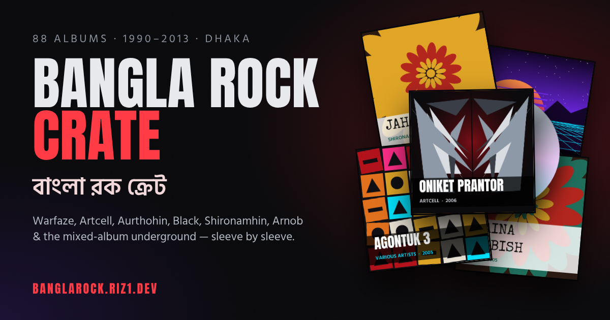
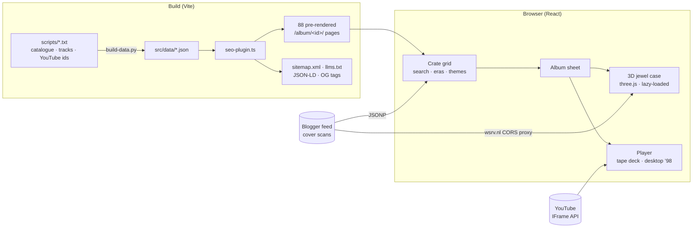

# Bangla Rock Crate — বাংলা রক ক্রেট

An interactive crate of 88 Bangladeshi rock, metal and fusion albums (1990–2013): real cover scans, a 3D jewel case, line-ups, track lists and a retro player.

**Live:** [banglarock.riz1.dev](https://banglarock.riz1.dev)



## Architecture



| Layer | What it does |
|---|---|
| `src/data/` | Album catalogue, line-ups, credits, tracks, YouTube ids |
| `src/feed.ts` | Pulls live cover URLs from the blog's feed; `covers.json` is the fallback |
| `src/cover.ts` | Era-styled generated artwork, shown while covers load |
| `src/components/CaseViewer.tsx` | WebGL jewel case and spinning disc (React Three Fiber) |
| `src/components/Player.tsx` | One YouTube engine, two skins: a cassette deck and a ’98 desktop player; falls through backup links if a video won't embed |
| `src/agent.ts` | Lets WebMCP browser agents read and drive the controls (loaded only when the browser supports it) |
| `src/seo.ts`, `scripts/seo-plugin.ts` | Per-album pages, structured data, sitemap, `llms.txt` |

**Stack:** Vite · React 19 · TypeScript · [ui-sdk](https://ui-sdk.dev) controls · three.js / React Three Fiber · plain CSS themes · Google Tag Manager

## Run

```bash
npm install
npm run dev     # local
npm test        # vitest: controls, keyboard, agent access
npm run build   # → dist/
```

## Credits

- **Catalogue & cover scans** — [Bangla CD Covers](https://banglacdcovers.blogspot.com/) by Shohail Ibne Mahbub (XTR)
- **Music** — streamed via YouTube; all music and artwork belong to the artists and labels
- **Controls** — [ui-sdk](https://github.com/vercel-labs/ui) by Vercel Labs (keyboard, focus, ARIA, agent bridge)
- **Image proxy** — [wsrv.nl](https://wsrv.nl)
- **Fonts** — Anton, Monoton, Special Elite, Hind Siliguri (Google Fonts)

Built by [Rizwanul Islam Rudra](https://riz1.dev).
